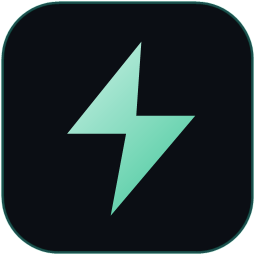
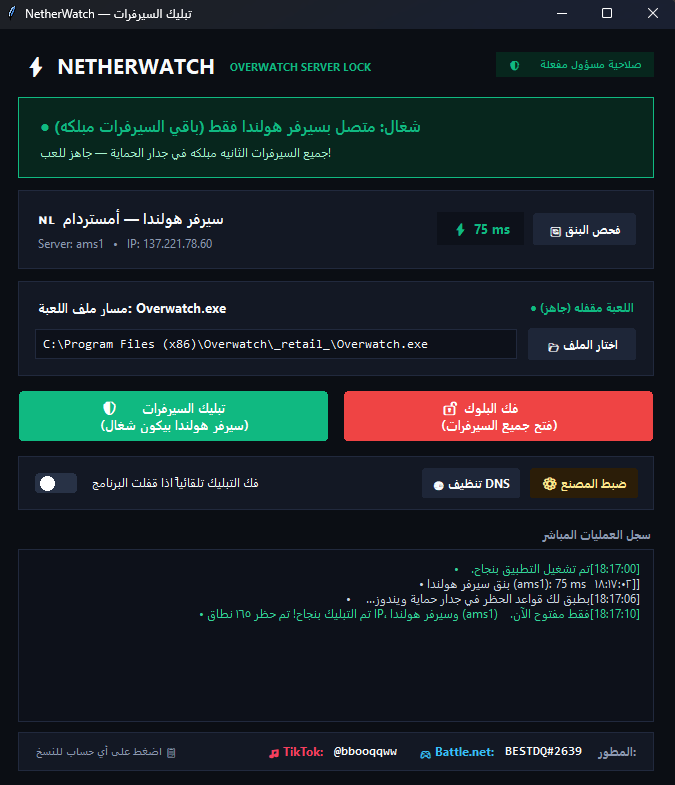

# ⚡ NetherWatch (OW2 Netherlands Only)

<!--
```ruby
OW2 // NETHERWATCH
```
-->

<table>
 <tr>
  <td align="center" width="130">
   
  </td>
  <td>
   <b>NetherWatch</b> — أداة محمولة وسريعة لتثبيت اتصالك في لعبة <b>Overwatch</b> على سيرفر هولندا فقط (<code>ams1</code>) وحظر باقي السيرفرات تلقائياً في جدار حماية ويندوز.
  </td>
  <td align="center">
    <a href="https://github.com/omar-hisham26/NetherWatch/raw/main/NetherWatch.exe">
     <p></p>
     <pre>⚡ تحميل البرنامج (NetherWatch.exe)</pre>
    </a>
  </td>
  <td align="center">
    <a href="https://github.com/omar-hisham26/NetherWatch/releases" target="_blank">
     <p></p>
     <pre>🏷️ الإصدارات (Releases)</pre>
    </a>
  </td>
 </tr>
</table>

<!--
## ملاحظات
- غير تابع إطلاقاً لشركة Blizzard Entertainment.
- الأداة آمنة 100% ولا تعدل على ملفات اللعبة، بل تعتمد على فلاتر Windows Firewall الرسمية.
-->

## طريقة الاستخدام (How to Use)
1. حمّل ملف البرنامج مباشرة من الزر أعلاه **[⚡ تحميل البرنامج (NetherWatch.exe)](https://github.com/omar-hisham26/NetherWatch/raw/main/NetherWatch.exe)**.
2. تأكد من **إغلاق اللعبة** أولاً (`Overwatch.exe`).
3. شغّل `NetherWatch.exe` كمسؤول (سيطلب الإذن تلقائياً لتعديل جدار الحماية).
4. اضغط على زر **🛡️ تبليك السيرفرات (سيرفر هولندا بيكون شغال)**.
5. انتهى! الآن افتح لعبة Overwatch واستمتع باللعب مباشرة على سيرفر هولندا (ams1).
6. يمكنك إغلاق التطبيق بعد التفعيل؛ التبليك يظل ثابتاً في نظام ويندوز حتى تفكه بنفسك (أو يمكنك تفعيل خيار: *فك التبليك تلقائياً اذا قفلت البرنامج*).
7. لفك الحظر والعودة لجميع سيرفرات العالم في أي وقت، افتح البرنامج واضغط **🔓 فك البلوك (فتح جميع السيرفرات)**.

## تنبيهات هامة (Warnings)
> [!IMPORTANT]
> <ul>
>   <li><b>اللعب الجماعي (Party / Group):</b> عند البحث عن قيم مع أصحابك في بارتي، قد يقوم نظام اللعبة (Matchmaker) بوضعكم في سيرفر آخر غير هولندا إلا إذا كان جميع أعضاء البارتي مفعلين التبليك أيضاً.</li>
>   <li><b>طور التدريب (Practice Range):</b> التدريب لا يعتمد على نظام الماتشميكنق الرسمي للسيرفرات؛ لتجربة وفحص الاتصال بسيرفر هولندا، جرّب الدخول في كستم قيم (Custom Game) أو ماتش سريع.</li>
>   <li><b>أثناء تشغيل اللعبة:</b> تختفي أزرار التفعيل والفك تلقائياً أثناء تشغيل Overwatch منعاً لأي تعارض؛ يجب إغلاق اللعبة أولاً لتغيير حالة السيرفرات.</li>
> </ul>

## الأسئلة الشائعة (FAQ)

| السؤال | الجواب |
| :--- | :--- |
| **هل البرنامج يسبب باند (Ban)؟** | **لا نهائياً.** البرنامج لا يحقن أي كود ولا يلمس ذاكرة اللعبة (RAM) أو ملف `Overwatch.exe`. هو فقط يضيف قواعد في جدار حماية ويندوز (Windows Firewall) لحظر الاتصال بآيبيات السيرفرات غير المرغوبة، تماماً كطريقة عمل مانع الإعلانات. |
| **هل أحتاج لتثبيت Python لتشغيل البرنامج؟** | **لا.** تم تجميع البرنامج في ملف تنفيذي مستقل بالكامل (`NetherWatch.exe`) لا يحتاج لتثبيت بايثون أو أي برامج إضافية. |
| **هل لازم أخلي البرنامج شغال في الخلفية؟** | **لا** — قواعد الحظر تبقى ثابتة ومفعلة في الويندوز حتى لو قفلت البرنامج، إلا إذا اخترت تفعيل خيار *فك التبليك تلقائياً اذا قفلت البرنامج*. |
| **كيف أحذف البرنامج وأرجع جهازي لوضعه الأصلي؟** | اضغط على زر **⚙️ ضبط المصنع** داخل البرنامج؛ سيقوم بحذف كافة القواعد من جدار الحماية، تنظيف كاش الـ DNS، ومسح الإعدادات المخزنة ليعود نظامك نظيفاً 100% كما كان. |
| **واجهت تعليق في البحث أو فشل اتصال؟** | اضغط على زر **🌐 تنظيف DNS** ثم جرب التفعيل مجدداً. |
| **كيف أعرف البنق قبل لا أدخل اللعبة؟** | يمكنك الضغط على زر **🔄 فحص البنق** في أي وقت لقياس البنق المباشر لسيرفر هولندا (`ams1 - 137.221.78.60`) بالمللي ثانية (ms). |

## الواجهة (Media)

<div align="center">
  
</div>

---

### حسابات المطور (Developer)
- 🎮 **Battle.net:** `BESTDQ#2639`
- 🎵 **TikTok:** [`@bbooqqww`](https://www.tiktok.com/@bbooqqww)
